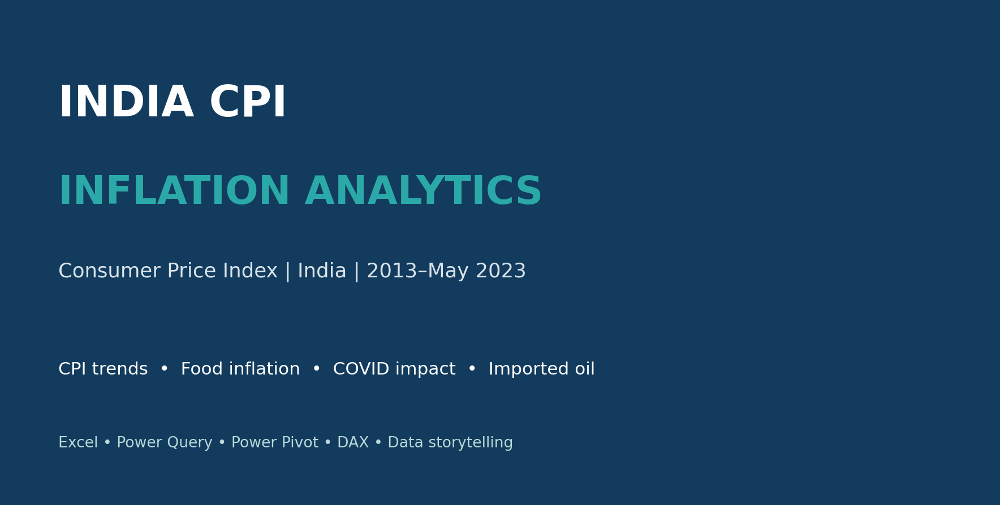
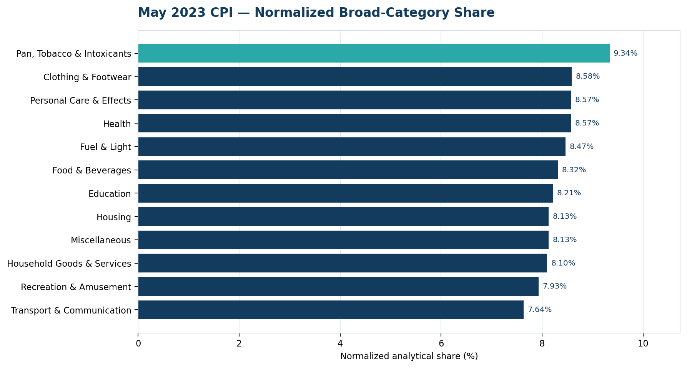
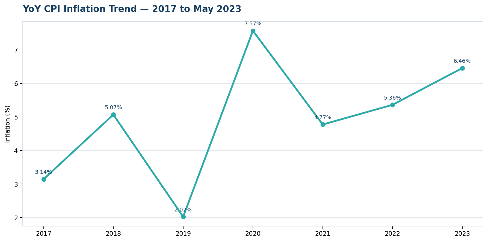
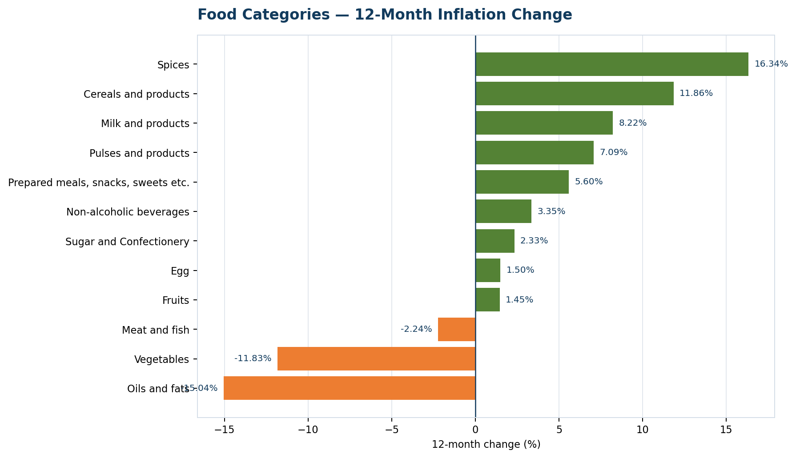
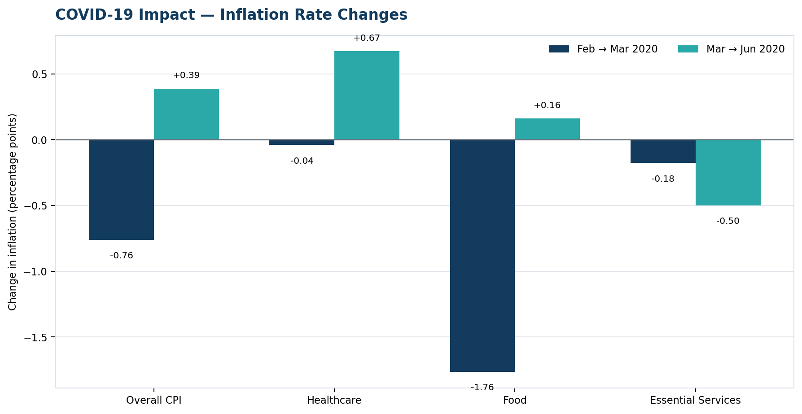
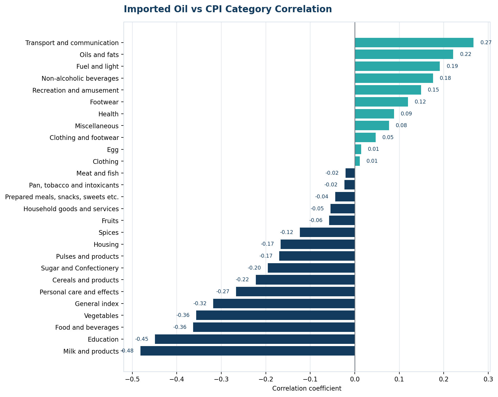

<div align="center">

# 🇮🇳 India CPI Inflation Analytics

### Consumer Price Index Analysis | 2013 – May 2023

**An end-to-end data analytics project exploring inflation trends, food prices, COVID-era changes, and the relationship between imported crude oil movements and CPI categories.**



   

</div>

---

## 📌 Project Overview

This project analyses India’s Consumer Price Index (CPI) from **January 2013 through May 2023**. It combines data cleaning, modelling, analytical measures, visualizations and insight-led reporting to answer five business questions. The project was built primarily in **Microsoft Excel**, using **Power Query** for preparation and **Power Pivot / DAX** for model-based analysis.

## 🎯 Business Questions

1. **Latest-month CPI contribution:** Compare broad categories for May 2023 and identify the highest normalized analytical share.
2. **Year-on-year inflation:** Review the YoY CPI trend from 2017 onward and identify the peak value in the project analysis.
3. **Food inflation:** Study the 12-month period ending May 2023, including monthly movement and category-level changes.
4. **COVID-19 impact:** Compare inflation-rate changes around March 2020 for overall CPI, healthcare, food and an analytical essential-services composite.
5. **Imported oil relationship:** Compare monthly Indian Basket crude-oil price changes with CPI category movements over the common available period from 2021 to May 2023.

## 🔍 Selected Findings

| Analysis | Key finding |
|---|---|
| May 2023 normalized category share | Pan, Tobacco & Intoxicants had the highest normalized analytical share at **9.34%**. |
| YoY CPI trend | The project’s annual YoY table recorded **7.57% for 2020** as its highest displayed value. |
| Food category movement | Spices recorded the largest positive 12-month change at **+16.34%**; Oils and fats recorded **−15.04%**. |
| COVID-era comparison | Inflation-rate changes varied across overall CPI, healthcare, food and essential services. |
| Imported oil association | Milk and products had the strongest absolute observed category correlation, **−0.482**. |

> **Interpretation notes:** Category shares are normalized analytical shares, not official CPI expenditure weights. 2023 is partial through May. “Essential Services” is an analytical unweighted composite, not an official weighted CPI group. Correlation indicates association and does not prove causation.

## 📊 Visual Results

### 1. May 2023 CPI category comparison



### 2. Year-on-year CPI inflation trend



### 3. Food-category 12-month changes



### 4. COVID-era inflation-rate changes



### 5. Imported oil and CPI category correlations



## 🧰 Tools & Skills

- **Excel:** PivotTables, charts, dashboard layout, KPI cards and filters.
- **Power Query:** Data-type standardization, text cleanup, missing-value audit, error handling, unpivoting and monthly comparisons.
- **Power Pivot:** Data Model, calendar table, relationships and reusable measures.
- **DAX:** YoY inflation, MoM comparisons, category-level metrics and analytical summaries.
- **Data storytelling:** Turning analysis into charts, insights and clear interpretation notes.

## 🗂️ Repository Structure

```text
india-cpi-inflation-analytics/
├── README.md
├── LICENSE
├── .gitignore
├── data/
│   ├── CPI_Inflation_Project.xlsx
│   ├── All_India_Index_Upto_April23.csv
│   └── Imported_Oil_Prices_2021_2023.xlsx
├── presentation/
│   └── CPI_Inflation_Professional_Insights_Presentation.pptx
├── images/
│   ├── project_cover.png
│   └── charts/
├── docs/
│   ├── methodology.md
│   ├── data_dictionary.md
│   └── sources.md
└── analysis/
    └── findings_summary.md
```

## 🚀 How to Explore

1. Open `data/CPI_Inflation_Project.xlsx` in desktop Microsoft Excel.
2. Start from the `CPI_Dashboard` sheet.
3. Explore the Q1–Q5 analysis sheets for supporting results.
4. Open the PowerPoint in `presentation/` for a concise presentation-ready summary.
5. Read `docs/` for methodology, data definitions and source notes.

**Compatibility:** Power Pivot and Data Model features depend on your Excel edition and platform. A refresh or compatible desktop Excel version may be required for full model functionality.

## 📚 Data & Sources

- CPI source: All India CPI dataset supplied with the project, January 2013–May 2023.
- Imported oil: PPAC Indian Basket crude-oil monthly prices.
- Review [`docs/sources.md`](docs/sources.md) for source notes.

## 👤 Author

**Anirudh Kumar Yadav** · Data Analytics Portfolio Project

This repository is intended for educational and portfolio demonstration. Preserve the original data publisher’s attribution and terms when reusing source data.
